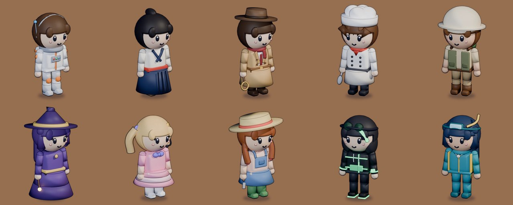

# PS-260 themed character sets

Ten themed sets, five male and five female (user request, 2026-11-25). Each
set is a protagonist, a room style and two decorations designed together. The
proposal and the segment plan are in
[`docs/ps-260-character-sets-proposal.md`](../../docs/ps-260-character-sets-proposal.md).

| Set | Gender | Protagonist | Room | Decorations |
|-----|--------|-------------|------|-------------|
| `astronaut` | male | 太空人: white suit, orange knee pads, life-support pack, chest panel, headset antenna | `spacestation` 太空站 | `deco-rocket` 火箭模型, `deco-planet` 行星燈 |
| `samurai` | male | 武士: white kimono with crossed collar, red obi, navy hakama, topknot, wooden sword | `dojo` 劍道場 | `deco-katana` 刀架, `deco-bonsai` 盆景 |
| `detective` | male | 偵探: tan trench coat with belt, red scarf, fedora, magnifying glass | `noir` 偵探事務所 | `deco-typewriter` 打字機, `deco-hatstand` 衣帽架 |
| `chef` | male | 主廚: double-breasted white jacket, red neckerchief, waist apron, toque, whisk | `bistro` 法式廚房 | `deco-cake` 蛋糕架, `deco-bread` 麵包籃 |
| `explorer` | male | 探險家: khaki shirt, olive vest, pith helmet, backpack with bedroll, boots | `jungle` 叢林營地 | `deco-fern` 蕨類盆栽, `deco-lantern` 探險油燈 |
| `witch` | female | 魔法師: purple robe, gold sash, pointed hat, wand with a glowing star | `wizard` 魔法塔 | `deco-crystal` 水晶球, `deco-potions` 魔藥瓶 |
| `idol` | female | 偶像: pink tiered dress, twin tails with ribbons, headset mic, white boots | `stage` 偶像練習室 | `deco-mic` 麥克風架, `deco-heartlamp` 愛心燈 |
| `gardener` | female | 園藝師: denim pinafore, braids, straw hat, green boots, trowel | `greenhouse` 溫室花房 | `deco-flowerpot` 花盆, `deco-wateringcan` 澆花壺 |
| `hacker` | female | 駭客: black techwear with glowing seams and soles, bob with a neon streak, goggles | `cyber` 賽博空間 | `deco-server` 伺服器機櫃, `deco-hologram` 全像投影 |
| `marine` | female | 海洋學家: teal wetsuit with yellow stripes, dive mask and snorkel, shell necklace | `ocean` 海底研究站 | `deco-aquarium` 水族箱, `deco-coral` 珊瑚燈 |



## Files

| File | Purpose |
|------|---------|
| `sets_catalog.py` | The ten sets (ids, labels, gender, room, decorations), poses, facings and runtime paths. Pure Python. |
| `characters.py` | The costumes: builds the PS-250C body (`ps250-characters/protagonists.py`, unchanged) and adds each set's pieces to its joints. |
| `render_sets.py` | Renders every protagonist sprite with the PS-250C camera, lights, outline and facings. |
| `process_sets.py` | Clip check, contact shadow, WebP, `outputs.json` and the previews, with the PS-250C helpers. |
| `outputs.json` | Ids, labels, gender, the set → room → decorations map, and the size and SHA-256 of every sprite. `tests/unit/ps260aCharacterSets.test.js` checks the files against it. |
| `process_pixel_sets.py` | PS-260D: the pixel protagonists, made from the committed sprites with the PS-250D reduction (`ps250-pixel/process_pixel.process_character`); writes `pixel-outputs.json`. |
| `pixel-outputs.json` | Size and SHA-256 of every pixel protagonist. `tests/unit/ps260dPixelProtagonists.test.js` checks the files against it. |
| `previews/` | `protagonists.jpg` (every pose and facing) and `lineup.jpg`; `pixel-protagonists.png` and `pixel-lineup.png` for the pixel versions. |

## How the costumes are built

- The body, face, hair styles, poses and facings are the PS-250C rig, so the
  sets stand, walk and celebrate exactly like the six PS-250C protagonists and
  the runtime draws them with the same placements.
- Every costume piece is parented to a rig joint (`neck` for hats and hair,
  `chest` for collars, packs and panels, `hips` for skirts and robes,
  `ankle_*` for boots, `elbow_*` for what the hand holds), so it follows every
  pose.
- Hats hang from one empty (`hat_root`) that carries the tilt, sit lower than
  the hair cap and are wider than it, as a real hat sits on the head. The
  canvas leaves about 0.1 m above the hair: the tallest hats (witch, toque)
  keep 7–8 px of headroom in `celebrate`, and `process_sets.py` fails any
  sprite that touches the canvas edge.
- `'outfit': 'plain'` is a torso without the PS-250C outfit details, for sets
  that bring their own front (a `tee` print showed through the witch's
  brooch).
- The female sets add eyelashes; glowing parts (the hacker's seams, the
  witch's wand) use an emission material like the room's neon.

## Reproduce

Blender's Python module (`pip install bpy`, Blender 5.2) and Pillow + numpy.

```bash
/tmp/bpyenv/bin/python art-pipeline/ps260-sets/render_sets.py /tmp/ps260-renders --samples 64
python3 art-pipeline/ps260-sets/process_sets.py /tmp/ps260-renders --write-runtime
```

About 8 s per sprite on a 4-core CPU (120 sprites, ~16 min). To change one set,
render only it (`--protagonists witch`), then run `process_sets.py
--write-runtime --reuse-committed`: sprites without a render keep their
committed WebP and hash. For a check-only run, pass `--preview-dir` with another
directory and leave out `--write-runtime`.

The pixel versions need no render: after changing the Q-style sprites, run

```bash
python3 art-pipeline/ps260-sets/process_pixel_sets.py --write-runtime
```

It always writes the previews, by default into the committed `previews/`; for
a check-only run pass `--preview-dir` with another directory and leave out
`--write-runtime`. `pixel-outputs.json` records the Q-style sprite each pixel
one was made from, so a re-render without this step fails the tests.
